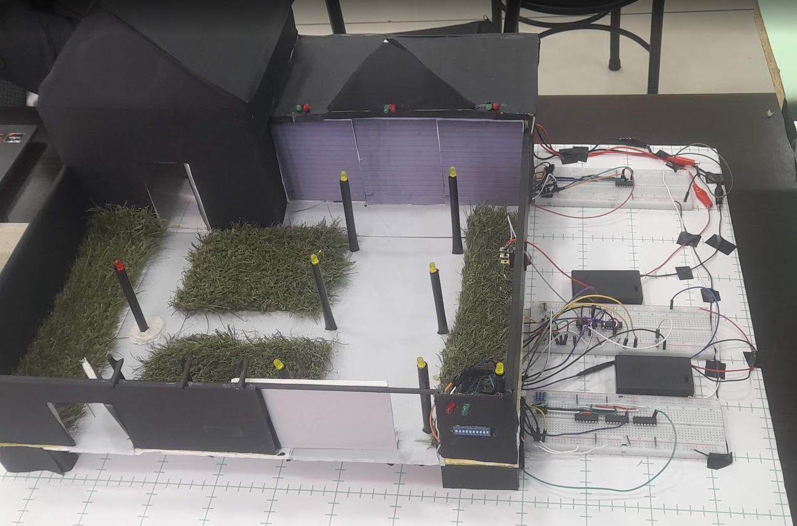
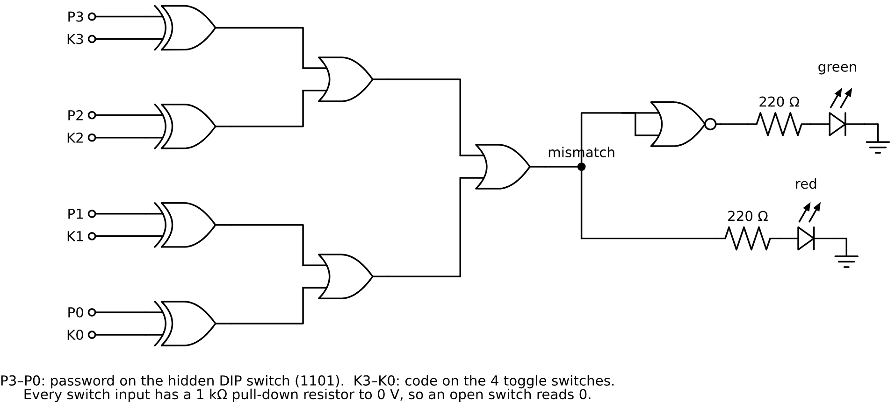
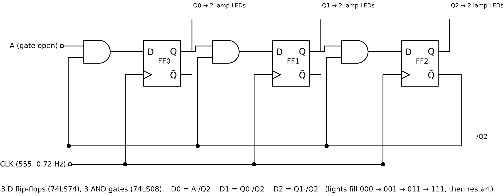
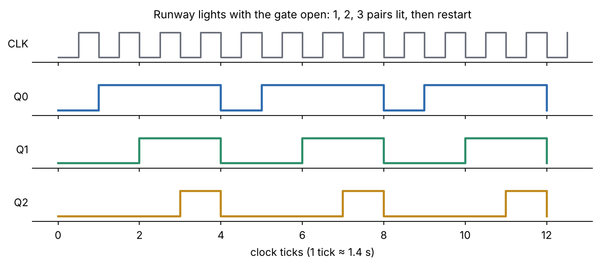
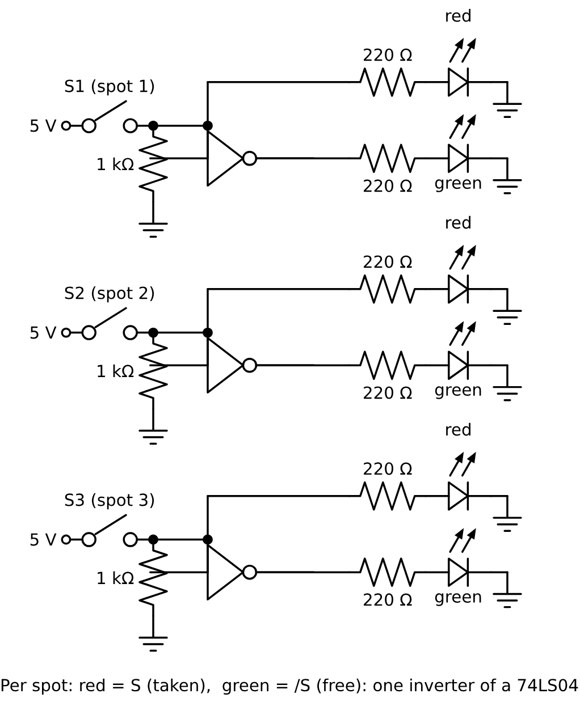

# Home Automation with Digital Logic (74LS series)

A model house with three logic circuits built from basic 74LS chips: a password lock for the gate, runway lights that switch on one pair after another, and parking spots that show red when taken and green when free. No microcontroller: only gates, flip-flops and a 555 timer.

**Built:** January 2024 · Digital Systems Lab course project

<p align="center">
  
</p>

**Demo video:** [media/demo.mp4](media/demo.mp4) (48 s). It shows power on, then a wrong code (red) and the correct code (green) at the gate. Then the parking spots switch between red and green, and the runway lamps light one pair after another.

## The three circuits

| Part | Inputs | Outputs | Chips |
| --- | --- | --- | --- |
| Gate lock | 4-bit password on a hidden DIP switch, 4 code switches | Green LED (open) or red LED (wrong code) | 74LS86 XOR ×4, 74LS32 OR ×3, NOR as inverter |
| Runway lights | Gate open (A), 555 clock | 3 pairs of lamp LEDs | 74LS74 D flip-flop ×3, 74LS08 AND ×3, 555 |
| Parking spots | One switch per spot (3) | Red and green LED per spot | 74LS04 inverter ×3 |

All switch inputs have a 1 kΩ pull-down resistor to 0 V. An unconnected 74LS input reads as logic 1, so without the resistor an open switch would look closed.

### Gate lock

The password (1101) is set on a DIP switch hidden inside the wall; the visitor enters a code on four toggle switches. Each XOR compares one bit and outputs 1 if the two bits differ. The ORs combine the four results into one "mismatch" signal:

- **Green** = NOT (D3 + D2 + D1 + D0), where Dn = Pn ⊕ Kn
- **Red** = D3 + D2 + D1 + D0

Exactly one LED is on at any time, and only one of the 16 possible codes lights the green LED. Changing the DIP switch changes the password without rewiring.

<p align="center"></p>

| Code K3 K2 K1 K0 (password 1101) | Green | Red |
| --- | --- | --- |
| 1101 | 1 | 0 |
| any of the other 15 codes | 0 | 1 |

### Runway lights

When the gate opens (A = 1), the lamp posts along the path light up one pair at a time, one step per clock tick, then start again. Three D flip-flops hold the state Q2 Q1 Q0, and each flip-flop drives one pair of lamp LEDs.

| State | Q2 Q1 Q0 | Lamps lit | Next state (A = 1) |
| --- | --- | --- | --- |
| S0 | 000 | none | S1 |
| S1 | 001 | pair 1 | S3 |
| S3 | 011 | pairs 1–2 | S7 |
| S7 | 111 | pairs 1–3 | S0 |

Next-state equations, from the state table with K-maps:

- D0 = A · Q̄2
- D1 = Q0 · Q̄2
- D2 = Q1 · Q̄2

The four unused states (010, 100, 101, 110) return to the sequence within 3 ticks, so the lights always recover after power-up. With the gate closed (A = 0) the lights switch off one pair per tick.

<p align="center"></p>
<p align="center"></p>

**Clock.** A 555 timer in astable mode with RA = 1 kΩ, RB = 100 kΩ and C = 10 µF:

- f = 1.44 / ((RA + 2·RB)·C) = 0.72 Hz, about one step every 1.4 s
- high 0.70 s, low 0.69 s: duty cycle 50 %

### Parking spots

Each spot has a switch that closes when a car is parked (pressure plates were the plan, but none were small enough for the model).

- Red = S (taken)
- Green = S̄ (free): one inverter per spot

The K-maps reduce to a single variable per output, so the whole part needs only one 74LS04.

<p align="center"></p>

## Repository layout

```
logic/
  home.py          logic model of the three circuits and the 555 timing
  draw.py          draws the schematics and the timing diagram
tests/test_home.py checks every input combination (256 for the lock) and the light sequence
original/          the CircuitMaker 2000 simulation files of the course project
  gate_password.CKT, runway_lights.CKT, parking_spots.CKT, clock_555.CKT
media/             photo, schematics, timing diagram
```

## Run it

Python 3.10+:

```
pip install pytest matplotlib schemdraw
pytest -q                  # 7 tests
python logic/draw.py       # redraws media/ (needs Playwright for the PNG export)
```

The `.CKT` files open in CircuitMaker 2000.

## Author

**Michel Salame** — [LinkedIn](https://www.linkedin.com/in/michel-salame)
